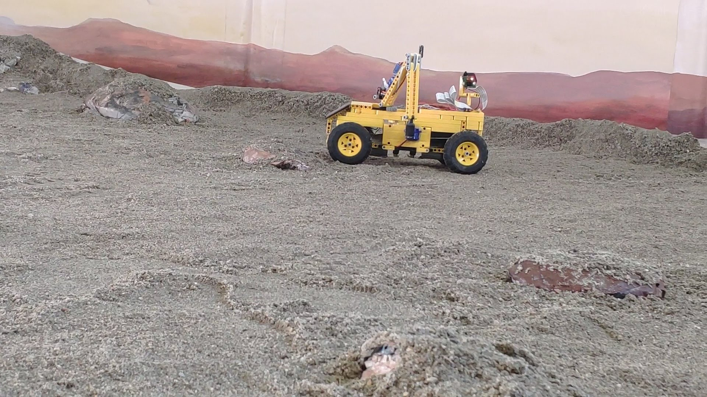
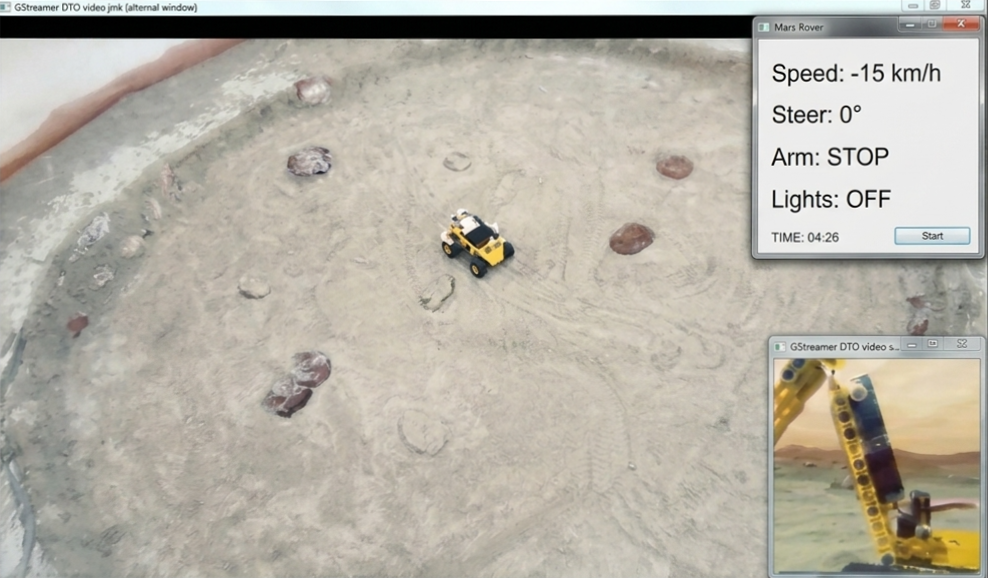
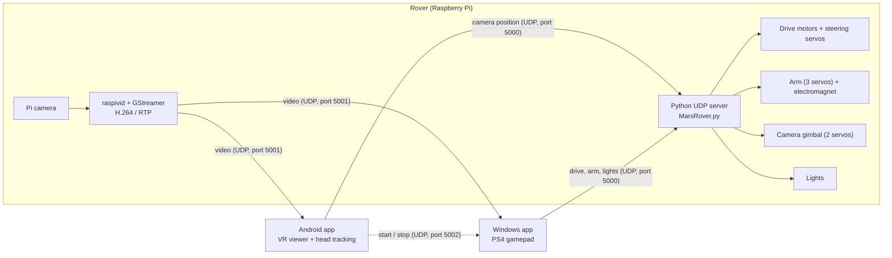

# Mars Rover

A Raspberry Pi 4 based rover with a robotic arm, driven remotely over Wi-Fi. The operator wears a phone-based VR headset and sees the rover's camera in stereo; turning the head turns the camera. Driving and the arm are controlled with a PlayStation 4 gamepad.




## How it works

- **Rover**: a Raspberry Pi runs a Python UDP server. It drives the motors and servos and streams the camera.
- **Phone (Android app)**: receives the video and shows it in VR (split screen). It reads the head orientation from the phone's sensors and sends only the camera position to the rover, which moves the camera accordingly. It also tells the PC app when to start and stop.
- **PC (Windows app)**: receives the same video stream and sends all the other commands, read from a PS4 gamepad: speed, steering, arm movement, electromagnet and lights.



## Features

- Low-latency H.264 video over UDP, received by both the phone and the PC.
- VR view on the phone with a two-eye layout. The head orientation comes from a sensor fusion of gyroscope, accelerometer and magnetometer, and drives a two-servo camera gimbal.
- Speed and steering from the gamepad.
- Robotic arm with 3 servo motors and an electromagnet to pick up objects.
- **Synchronized arm motion**: the arm is commanded in Cartesian space. The Pi solves the inverse kinematics of the linkage and moves the servos together, so one button press gives a pure up / down or forward / back movement of the gripper, with joint-limit checks.
- Lights, switchable from the gamepad.

## Hardware

- LEGO rover chassis
- Raspberry Pi with the Pi camera
- Adafruit PCA9685 servo driver and Motor HAT, over I2C (libraries `Adafruit_PCA9685` and `Adafruit_MotorHAT`)
- 2 DC drive motors and 2 steering servos
- 3 servos for the arm and an electromagnet
- 2 servos for the camera gimbal, and lights
- Android phone and VR headset, Windows PC and a PS4 controller

## Repository layout

```
raspberry-pi/   MarsRover.py (UDP server, motors, servos, arm kinematics), stream.sh / streampc.sh (video streaming)
android/        Android Studio project (package com.example.marsrover): VR viewer, head tracking, settings, GStreamer (native) video player
windows/        Visual Studio (VB.NET) project: gamepad input (SharpDX DirectInput), UDP client, video viewer
```

## Control protocol

The rover listens on a single UDP port (5000). Both clients send fixed-length ASCII packets of 11 characters; the server tells them apart by the first and last character.

**Drive packet** (Windows app): `b` + steering + speed + lights + arm + electromagnet + `e`

| Chars | Field | Meaning |
| --- | --- | --- |
| 0 | `b` | start marker |
| 1-3 | steering | 280-500, servo pulse ticks (the second steering servo is mirrored: 780 - value) |
| 4-6 | speed | 0-130 forward, 131-261 reverse (PWM speed = value, or value - 131) |
| 7 | lights | `0` / `1` |
| 8 | arm direction | `f` forward, `b` back, `u` up, `d` down, `r` / `l` rotate the base, `0` stop |
| 9 | electromagnet | `0` / `1` |
| 10 | `e` | end marker |

**Camera packet** (Android app): `c` + X + Y + `000` + `f`

| Chars | Field | Meaning |
| --- | --- | --- |
| 0 | `c` | start marker |
| 1-3 | camera X | pan, 220-580 (servo pulse ticks) |
| 4-6 | camera Y | tilt, 230-550 (servo pulse ticks) |
| 7-9 | `000` | unused |
| 10 | `f` | end marker |

The phone also sends the text `start` / `stop` to the PC app (UDP port 5002) when the video starts or stops.

## Video

The Pi streams the camera with `raspivid` piped into GStreamer (`rtph264pay` + `udpsink`):

- `raspberry-pi/stream.sh`: low-resolution stream to the phone.
- `raspberry-pi/streampc.sh`: higher-resolution stream to the PC. Set `YOUR_PC_IP` before use.

The receivers use `udpsrc` + `rtph264depay` + `avdec_h264`. The Windows app can also overlay a webcam on the stream (picture-in-picture).

## Build and run

**Raspberry Pi**

```bash
pip install Adafruit-PCA9685 Adafruit-MotorHAT
sudo python3 MarsRover.py
```

The script starts the stream itself with `stream.sh`; adapt the path and the phone's IP address in the file.

**Android app**

1. Install Android Studio, the NDK (version in `app/build.gradle`) and the [GStreamer Android SDK](https://gstreamer.freedesktop.org/download/).
2. Set the `GSTREAMER_ROOT_ANDROID` environment variable to the unpacked SDK.
3. Open the `android/` folder in Android Studio, build and install. In the settings screen set the rover's IP address and port, the PC's IP address and port (5002), and the timer.

**Windows app**

1. Install Visual Studio and [GStreamer for Windows](https://gstreamer.freedesktop.org/download/) (the app expects `C:\gstreamer\1.0\x86_64`).
2. Restore the NuGet packages (SharpDX, SharpDX.DirectInput) and build.
3. Connect the PS4 controller, start the app, and enter the rover IP and the ports.

## Credits

- The Android video player is based on the GStreamer Android tutorials (LGPL).

